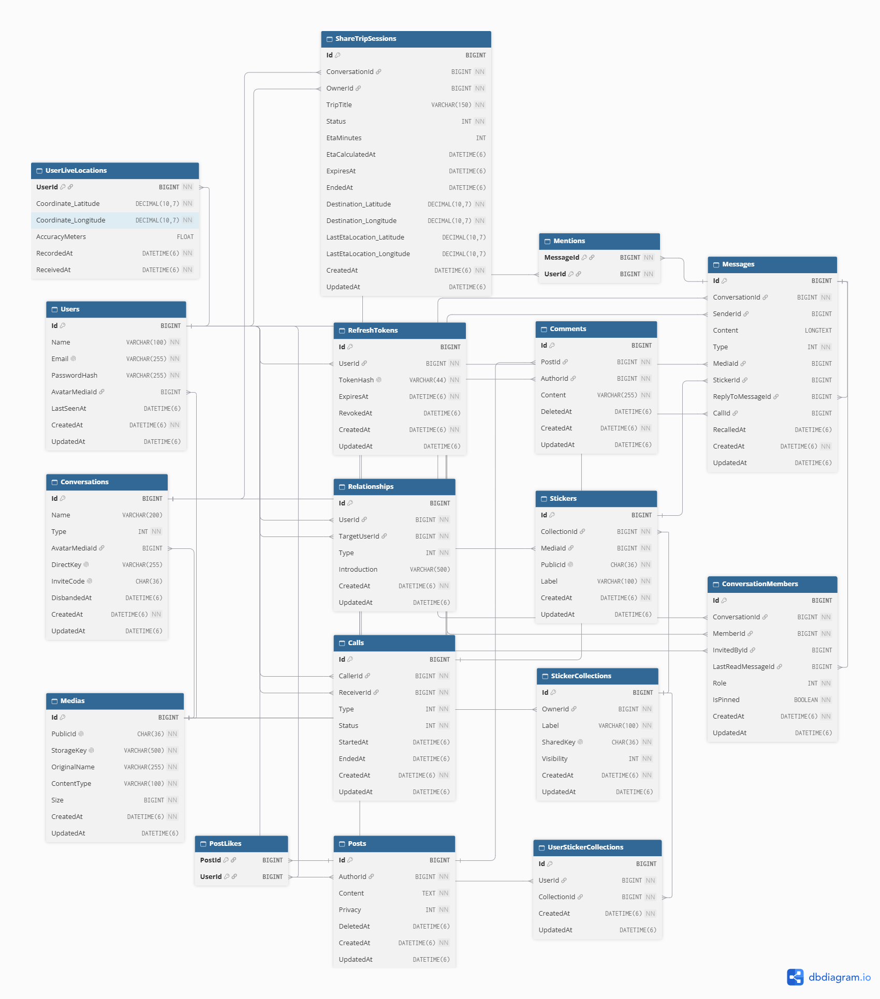
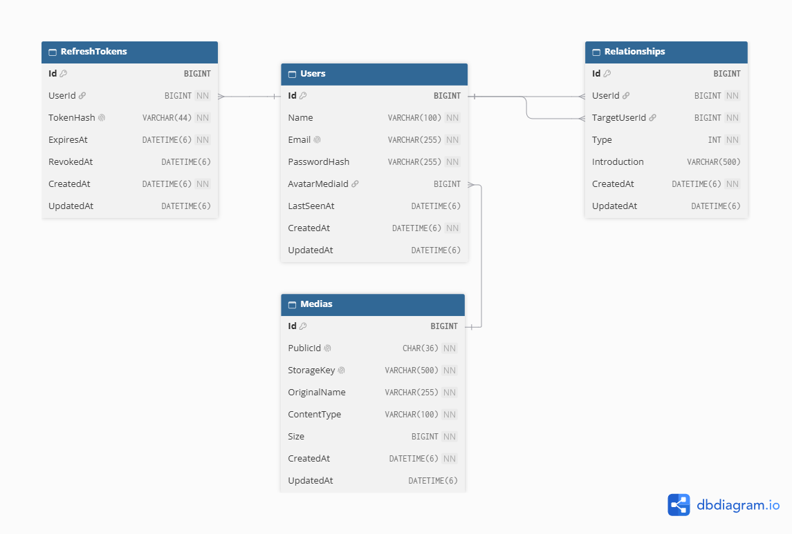
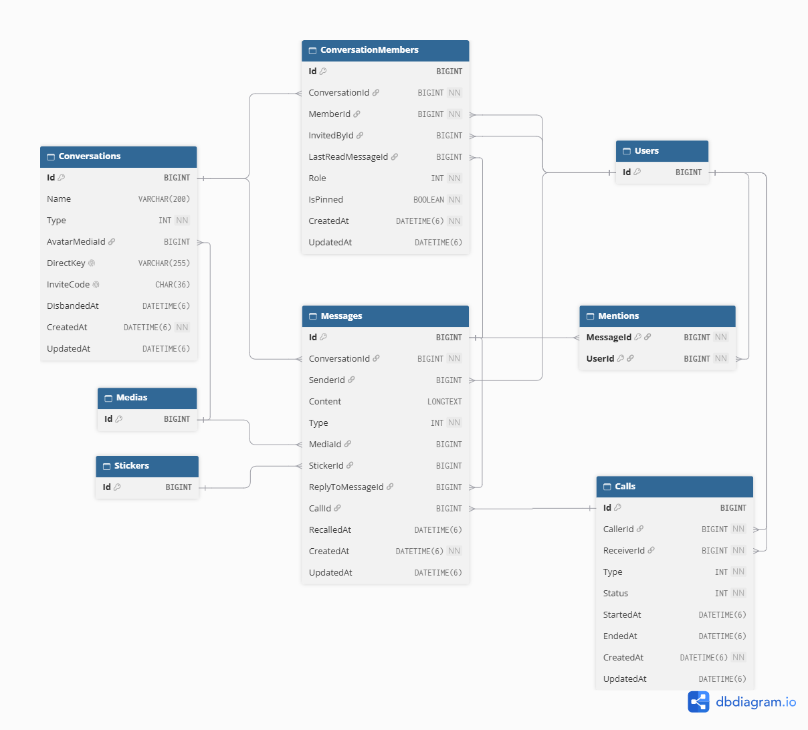
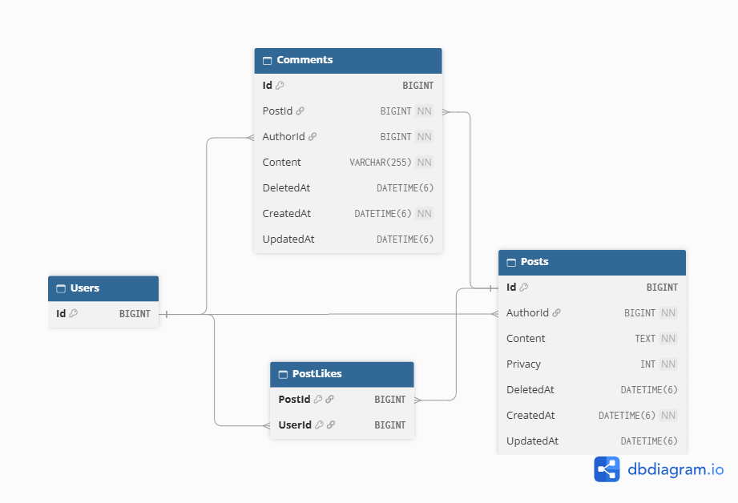
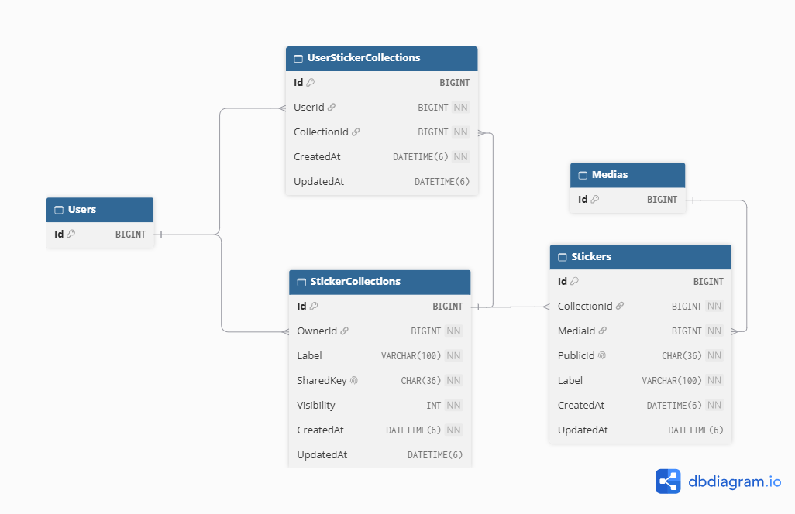
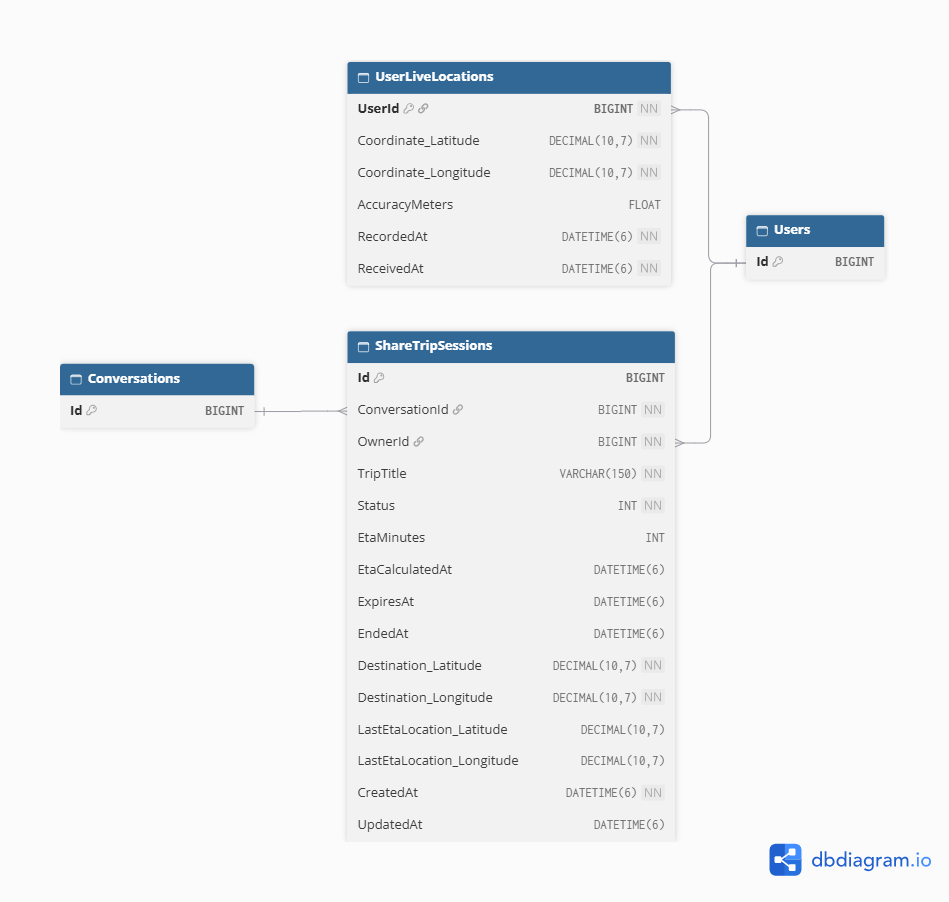

# RealtimeChat — Tài liệu thiết kế cơ sở dữ liệu

Tài liệu này mô tả cấu trúc cơ sở dữ liệu của RealtimeChat, bao gồm sơ đồ ERD, thông tin các bảng, ràng buộc và chỉ mục.

## ERD Diagrams

### Tổng quan

### Theo nhóm nghiệp vụ

#### 1. Tài khoản và quan hệ người dùng

#### 2. Nhắn tin và cuộc gọi

#### 3. Bài viết

#### 4. Thư viện sticker

#### 5. Chia sẻ vị trí và hành trình

---

## Cấu trúc cơ sở dữ liệu

### 1. `Users`

Lưu thông tin tài khoản người dùng.
| Cột | Kiểu dữ liệu | Khóa / Ràng buộc | Mô tả | Bảng tham chiếu (FK) |
|---|---|---|---|---|
| `Id` | `BIGINT` | PK, NOT NULL | Mã người dùng. | — |
| `Name` | `VARCHAR(100)` | NOT NULL | Tên người dùng. | — |
| `Email` | `VARCHAR(255)` | UNIQUE, NOT NULL | Email đăng nhập. | — |
| `PasswordHash` | `VARCHAR(255)` | NOT NULL | Hash mật khẩu. | — |
| `AvatarMediaId` | `BIGINT` | FK, NULL | Ảnh đại diện. | `Medias.Id` |
| `LastSeenAt` | `DATETIME(6)` | NULL | Thời điểm hoạt động gần nhất được ghi nhận. | — |
| `CreatedAt` | `DATETIME(6)` | NOT NULL | Thời điểm tạo tài khoản. | — |
| `UpdatedAt` | `DATETIME(6)` | NULL | Thời điểm cập nhật gần nhất. | — |

**Indexes**
| Cột được đánh chỉ mục | Loại | Mục đích |
|---|---|---|
| `AvatarMediaId` | Non-unique | Tra cứu người dùng theo ảnh đại diện. |
| `Email` | Unique | Đảm bảo email không trùng. |

### 2. `Medias`

Lưu metadata của tệp phương tiện được sử dụng trong ứng dụng.
| Cột | Kiểu dữ liệu | Khóa / Ràng buộc | Mô tả | Bảng tham chiếu (FK) |
|---|---|---|---|---|
| `Id` | `BIGINT` | PK, NOT NULL | Mã tệp phương tiện. | — |
| `PublicId` | `CHAR(36)` | UNIQUE, NOT NULL | Mã định danh công khai. | — |
| `StorageKey` | `VARCHAR(500)` | UNIQUE, NOT NULL | Khóa tệp trong hệ thống lưu trữ. | — |
| `OriginalName` | `VARCHAR(255)` | NOT NULL | Tên tệp ban đầu. | — |
| `ContentType` | `VARCHAR(100)` | NOT NULL | Loại nội dung của tệp. | — |
| `Size` | `BIGINT` | NOT NULL | Kích thước tệp. | — |
| `CreatedAt` | `DATETIME(6)` | NOT NULL | Thời điểm tạo bản ghi. | — |
| `UpdatedAt` | `DATETIME(6)` | NULL | Thời điểm cập nhật gần nhất. | — |

**Indexes**
| Cột được đánh chỉ mục | Loại | Mục đích |
|---|---|---|
| `PublicId` | Unique | Đảm bảo mã công khai không trùng. |
| `StorageKey` | Unique | Đảm bảo khóa lưu trữ không trùng. |

### 3. `RefreshTokens`

Lưu refresh token phục vụ xác thực và duy trì phiên đăng nhập.
| Cột | Kiểu dữ liệu | Khóa / Ràng buộc | Mô tả | Bảng tham chiếu (FK) |
|---|---|---|---|---|
| `Id` | `BIGINT` | PK, NOT NULL | Mã refresh token. | — |
| `UserId` | `BIGINT` | FK, NOT NULL | Người dùng sở hữu token. | `Users.Id` |
| `TokenHash` | `VARCHAR(44)` | UNIQUE, NOT NULL | Hash của token. | — |
| `ExpiresAt` | `DATETIME(6)` | NOT NULL | Thời điểm token hết hạn. | — |
| `RevokedAt` | `DATETIME(6)` | NULL | Thời điểm token bị thu hồi. | — |
| `CreatedAt` | `DATETIME(6)` | NOT NULL | Thời điểm tạo token. | — |
| `UpdatedAt` | `DATETIME(6)` | NULL | Thời điểm cập nhật gần nhất. | — |

**Indexes**
| Cột được đánh chỉ mục | Loại | Mục đích |
|---|---|---|
| `TokenHash` | Unique | Đảm bảo hash token không trùng. |
| `UserId` | Non-unique | Tra cứu token theo người dùng. |

### 4. `Relationships`

Lưu các quan hệ giữa người dùng; loại quan hệ được phân biệt bằng `Type`.
| Cột | Kiểu dữ liệu | Khóa / Ràng buộc | Mô tả | Bảng tham chiếu (FK) |
|---|---|---|---|---|
| `Id` | `BIGINT` | PK, NOT NULL | Mã quan hệ. | — |
| `UserId` | `BIGINT` | FK, NOT NULL | Người dùng tạo quan hệ. | `Users.Id` |
| `TargetUserId` | `BIGINT` | FK, NOT NULL | Người dùng đích của quan hệ. | `Users.Id` |
| `Type` | `INT` | NOT NULL | Loại quan hệ: `FriendRequest`, `Friend`, `Block`. | — |
| `Introduction` | `VARCHAR(500)` | NULL | Lời giới thiệu hoặc ghi chú. | — |
| `CreatedAt` | `DATETIME(6)` | NOT NULL | Thời điểm tạo quan hệ. | — |
| `UpdatedAt` | `DATETIME(6)` | NULL | Thời điểm cập nhật gần nhất. | — |

**Indexes**
| Cột được đánh chỉ mục | Loại | Mục đích |
|---|---|---|
| `TargetUserId` | Non-unique | Tra cứu các quan hệ hướng đến một người dùng. |
| `(UserId, TargetUserId, Type)` | Composite, unique | Không cho phép trùng cùng người dùng, người dùng đích và loại quan hệ. |

**Quy ước theo loại quan hệ**

- `FriendRequest`: Có hướng, A gửi yêu cầu cho B khác với B gửi yêu cầu cho A.
- `Block`: Có hướng, A chặn B không đồng nghĩa B chặn A.
- `Friend`: Quan hệ vô hướng. Chỉ lưu một bản ghi cho mỗi cặp bạn bè, quy ước `UserId = MIN(A, B)` và `TargetUserId = MAX(A, B)`.

### 5. `Conversations`

Lưu thông tin các cuộc trò chuyện trực tiếp hoặc nhóm.
| Cột | Kiểu dữ liệu | Khóa / Ràng buộc | Mô tả | Bảng tham chiếu (FK) |
|---|---|---|---|---|
| `Id` | `BIGINT` | PK, NOT NULL | Mã cuộc trò chuyện. | — |
| `Name` | `VARCHAR(200)` | NULL | Tên cuộc trò chuyện. | — |
| `Type` | `INT` | NOT NULL | Loại cuộc trò chuyện: `Direct`, `Group` | — |
| `AvatarMediaId` | `BIGINT` | FK, NULL | Ảnh đại diện cuộc trò chuyện. | `Medias.Id` |
| `DirectKey` | `VARCHAR(255)` | UNIQUE, NULL | Khóa định danh cuộc trò chuyện trực tiếp. | — |
| `InviteCode` | `CHAR(36)` | UNIQUE, NULL | Mã mời tham gia. | — |
| `DisbandedAt` | `DATETIME(6)` | NULL | Thời điểm giải tán, nếu có. | — |
| `CreatedAt` | `DATETIME(6)` | NOT NULL | Thời điểm tạo cuộc trò chuyện. | — |
| `UpdatedAt` | `DATETIME(6)` | NULL | Thời điểm cập nhật gần nhất. | — |

**Indexes**
| Cột được đánh chỉ mục | Loại | Mục đích |
|---|---|---|
| `AvatarMediaId` | Non-unique | Tra cứu theo ảnh đại diện. |
| `DirectKey` | Unique | Đảm bảo khóa cuộc trò chuyện trực tiếp không trùng. |
| `InviteCode` | Unique | Đảm bảo mã mời không trùng. |

### 6. `ConversationMembers`

Lưu thành viên của từng cuộc trò chuyện và trạng thái riêng của thành viên.
| Cột | Kiểu dữ liệu | Khóa / Ràng buộc | Mô tả | Bảng tham chiếu (FK) |
|---|---|---|---|---|
| `Id` | `BIGINT` | PK, NOT NULL | Mã bản ghi thành viên. | — |
| `ConversationId` | `BIGINT` | FK, NOT NULL | Cuộc trò chuyện tham gia. | `Conversations.Id` |
| `MemberId` | `BIGINT` | FK, NOT NULL | Người dùng tham gia. | `Users.Id` |
| `InvitedById` | `BIGINT` | FK, NULL | Người mời tham gia; để trống nếu tham gia qua liên kết mời. | `Users.Id` |
| `LastReadMessageId` | `BIGINT` | FK, NULL | Tin nhắn đọc gần nhất được ghi nhận. | `Messages.Id` |
| `Role` | `INT` | NOT NULL | Vai trò thành viên: `Admin`, `Member` | — |
| `IsPinned` | `TINYINT(1)` | NOT NULL | Trạng thái ghim cuộc trò chuyện của thành viên. | — |
| `CreatedAt` | `DATETIME(6)` | NOT NULL | Thời điểm tham gia. | — |
| `UpdatedAt` | `DATETIME(6)` | NULL | Thời điểm cập nhật gần nhất. | — |

**Indexes**
| Cột được đánh chỉ mục | Loại | Mục đích |
|---|---|---|
| `InvitedById` | Non-unique | Tra cứu thành viên theo người mời. |
| `LastReadMessageId` | Non-unique | Tra cứu theo tin nhắn đọc gần nhất. |
| `MemberId` | Non-unique | Tra cứu các cuộc trò chuyện của người dùng. |
| `(ConversationId, MemberId)` | Composite, unique | Đảm bảo mỗi người dùng chỉ có một bản ghi thành viên trong một cuộc trò chuyện. |

### 7. `Messages`

Lưu tin nhắn trong cuộc trò chuyện, gồm nội dung, trả lời, tệp đính kèm, sticker và cuộc gọi liên quan.
| Cột | Kiểu dữ liệu | Khóa / Ràng buộc | Mô tả | Bảng tham chiếu (FK) |
|---|---|---|---|---|
| `Id` | `BIGINT` | PK, NOT NULL | Mã tin nhắn. | — |
| `ConversationId` | `BIGINT` | FK, NOT NULL | Cuộc trò chuyện chứa tin nhắn. | `Conversations.Id` |
| `SenderId` | `BIGINT` | FK, NULL | Người gửi tin nhắn. | `Users.Id` |
| `Content` | `LONGTEXT` | NULL | Nội dung tin nhắn. | — |
| `Type` | `INT` | NOT NULL | Loại tin nhắn: `Text`, `Media`, `Sticker`, `Call`, `System` | — |
| `MediaId` | `BIGINT` | FK, NULL | Tệp phương tiện đính kèm. | `Medias.Id` |
| `StickerId` | `BIGINT` | FK, NULL | Sticker được gửi. | `Stickers.Id` |
| `ReplyToMessageId` | `BIGINT` | FK, NULL | Tin nhắn được trả lời. | `Messages.Id` |
| `CallId` | `BIGINT` | FK, NULL | Cuộc gọi liên quan. | `Calls.Id` |
| `RecalledAt` | `DATETIME(6)` | NULL | Thời điểm thu hồi, nếu có. | — |
| `CreatedAt` | `DATETIME(6)` | NOT NULL | Thời điểm tạo tin nhắn. | — |
| `UpdatedAt` | `DATETIME(6)` | NULL | Thời điểm cập nhật gần nhất. | — |

**Indexes**
| Cột được đánh chỉ mục | Loại | Mục đích |
|---|---|---|
| `CallId` | Non-unique | Tra cứu tin nhắn theo cuộc gọi. |
| `MediaId` | Non-unique | Tra cứu theo tệp đính kèm. |
| `ReplyToMessageId` | Non-unique | Tra cứu các tin nhắn trả lời một tin nhắn. |
| `SenderId` | Non-unique | Tra cứu tin nhắn theo người gửi. |
| `StickerId` | Non-unique | Tra cứu theo sticker. |
| `(ConversationId, CreatedAt)` | Composite, non-unique | Tra cứu tin nhắn trong cuộc trò chuyện theo thời gian. |

### 8. `Mentions`

Lưu người dùng được nhắc đến trong tin nhắn. Khóa chính gồm `MessageId` và `UserId`.
| Cột | Kiểu dữ liệu | Khóa / Ràng buộc | Mô tả | Bảng tham chiếu (FK) |
|---|---|---|---|---|
| `MessageId` | `BIGINT` | PK (composite), FK, NOT NULL | Tin nhắn chứa lượt nhắc đến. | `Messages.Id` |
| `UserId` | `BIGINT` | PK (composite), FK, NOT NULL | Người dùng được nhắc đến. | `Users.Id` |

**Indexes**
| Cột được đánh chỉ mục | Loại | Mục đích |
|---|---|---|
| `UserId` | Non-unique | Tra cứu các lượt nhắc đến người dùng. |

### 9. `Calls`

Lưu thông tin cuộc gọi giữa hai người dùng.
| Cột | Kiểu dữ liệu | Khóa / Ràng buộc | Mô tả | Bảng tham chiếu (FK) |
|---|---|---|---|---|
| `Id` | `BIGINT` | PK, NOT NULL | Mã cuộc gọi. | — |
| `CallerId` | `BIGINT` | FK, NOT NULL | Người khởi tạo cuộc gọi. | `Users.Id` |
| `ReceiverId` | `BIGINT` | FK, NOT NULL | Người nhận cuộc gọi. | `Users.Id` |
| `Type` | `INT` | NOT NULL | Loại cuộc gọi: `Audio`, `Video` | — |
| `Status` | `INT` | NOT NULL | Trạng thái cuộc gọi `Ringing`, `Accepted`, `Rejected`, `Cancelled`, `Missed`, `Ended` | — |
| `StartedAt` | `DATETIME(6)` | NULL | Thời điểm bắt đầu. | — |
| `EndedAt` | `DATETIME(6)` | NULL | Thời điểm kết thúc. | — |
| `CreatedAt` | `DATETIME(6)` | NOT NULL | Thời điểm tạo bản ghi. | — |
| `UpdatedAt` | `DATETIME(6)` | NULL | Thời điểm cập nhật gần nhất. | — |

**Indexes**
| Cột được đánh chỉ mục | Loại | Mục đích |
|---|---|---|
| `CallerId` | Non-unique | Tra cứu cuộc gọi theo người gọi. |
| `ReceiverId` | Non-unique | Tra cứu cuộc gọi theo người nhận. |

### 10. `Posts`

Lưu bài viết của người dùng.
| Cột | Kiểu dữ liệu | Khóa / Ràng buộc | Mô tả | Bảng tham chiếu (FK) |
|---|---|---|---|---|
| `Id` | `BIGINT` | PK, NOT NULL | Mã bài viết. | — |
| `AuthorId` | `BIGINT` | FK, NOT NULL | Người tạo bài viết. | `Users.Id` |
| `Content` | `TEXT` | NOT NULL | Nội dung bài viết. | — |
| `Privacy` | `INT` | NOT NULL | Phạm vi hiển thị: `Public`, `Friends`, `Private`. | — |
| `DeletedAt` | `DATETIME(6)` | NULL | Thời điểm xóa, nếu có. | — |
| `CreatedAt` | `DATETIME(6)` | NOT NULL | Thời điểm tạo bài viết. | — |
| `UpdatedAt` | `DATETIME(6)` | NULL | Thời điểm cập nhật gần nhất. | — |

**Indexes**
| Cột được đánh chỉ mục | Loại | Mục đích |
|---|---|---|
| `(AuthorId, CreatedAt)` | Composite, non-unique | Tra cứu bài viết theo tác giả và thời gian tạo. |

### 11. `Comments`

Lưu bình luận của người dùng trên bài viết.
| Cột | Kiểu dữ liệu | Khóa / Ràng buộc | Mô tả | Bảng tham chiếu (FK) |
|---|---|---|---|---|
| `Id` | `BIGINT` | PK, NOT NULL | Mã bình luận. | — |
| `PostId` | `BIGINT` | FK, NOT NULL | Bài viết được bình luận. | `Posts.Id` |
| `AuthorId` | `BIGINT` | FK, NOT NULL | Người viết bình luận. | `Users.Id` |
| `Content` | `VARCHAR(255)` | NOT NULL | Nội dung bình luận. | — |
| `DeletedAt` | `DATETIME(6)` | NULL | Thời điểm xóa, nếu có. | — |
| `CreatedAt` | `DATETIME(6)` | NOT NULL | Thời điểm tạo bình luận. | — |
| `UpdatedAt` | `DATETIME(6)` | NULL | Thời điểm cập nhật gần nhất. | — |

**Indexes**
| Cột được đánh chỉ mục | Loại | Mục đích |
|---|---|---|
| `AuthorId` | Non-unique | Tra cứu bình luận theo tác giả. |
| `DeletedAt` | Non-unique | Lọc bình luận theo thời điểm xóa. |
| `(PostId, CreatedAt)` | Composite, non-unique | Tra cứu bình luận của bài viết theo thời gian. |

### 12. `PostLikes`

Lưu lượt thích bài viết của người dùng.
| Cột | Kiểu dữ liệu | Khóa / Ràng buộc | Mô tả | Bảng tham chiếu (FK) |
|---|---|---|---|---|
| `PostId` | `BIGINT` | PK, FK, NOT NULL | Bài viết được thích. | `Posts.Id` |
| `UserId` | `BIGINT` | PK, FK, NOT NULL | Người dùng thích bài viết. | `Users.Id` |

Khóa chính ghép `(PostId, UserId)` đảm bảo mỗi người dùng chỉ có một lượt thích trên mỗi bài viết.

### 13. `StickerCollections`

Lưu bộ sưu tập sticker do người dùng sở hữu hoặc chia sẻ.
| Cột | Kiểu dữ liệu | Khóa / Ràng buộc | Mô tả | Bảng tham chiếu (FK) |
|---|---|---|---|---|
| `Id` | `BIGINT` | PK, NOT NULL | Mã bộ sưu tập. | — |
| `OwnerId` | `BIGINT` | FK, NOT NULL | Người sở hữu bộ sưu tập. | `Users.Id` |
| `Label` | `VARCHAR(100)` | NOT NULL | Tên bộ sưu tập. | — |
| `SharedKey` | `CHAR(36)` | UNIQUE, NOT NULL | Mã chia sẻ bộ sưu tập. | — |
| `Visibility` | `INT` | NOT NULL | Phạm vi hiển thị của bộ sưu tập: `Private`, `Public` | — |
| `CreatedAt` | `DATETIME(6)` | NOT NULL | Thời điểm tạo bộ sưu tập. | — |
| `UpdatedAt` | `DATETIME(6)` | NULL | Thời điểm cập nhật gần nhất. | — |

**Indexes**
| Cột được đánh chỉ mục | Loại | Mục đích |
|---|---|---|
| `OwnerId` | Non-unique | Tra cứu bộ sưu tập theo chủ sở hữu. |
| `SharedKey` | Unique | Đảm bảo mã chia sẻ không trùng. |

### 14. `Stickers`

Lưu sticker thuộc một bộ sưu tập.
| Cột | Kiểu dữ liệu | Khóa / Ràng buộc | Mô tả | Bảng tham chiếu (FK) |
|---|---|---|---|---|
| `Id` | `BIGINT` | PK, NOT NULL | Mã sticker. | — |
| `CollectionId` | `BIGINT` | FK, NOT NULL | Bộ sưu tập chứa sticker. | `StickerCollections.Id` |
| `MediaId` | `BIGINT` | FK, NOT NULL | Tệp phương tiện của sticker. | `Medias.Id` |
| `PublicId` | `CHAR(36)` | UNIQUE, NOT NULL | Mã định danh công khai. | — |
| `Label` | `VARCHAR(100)` | NOT NULL | Nhãn sticker. | — |
| `CreatedAt` | `DATETIME(6)` | NOT NULL | Thời điểm tạo sticker. | — |
| `UpdatedAt` | `DATETIME(6)` | NULL | Thời điểm cập nhật gần nhất. | — |

**Indexes**
| Cột được đánh chỉ mục | Loại | Mục đích |
|---|---|---|
| `CollectionId` | Non-unique | Tra cứu sticker theo bộ sưu tập. |
| `MediaId` | Non-unique | Tra cứu sticker theo tệp phương tiện. |
| `PublicId` | Unique | Đảm bảo mã công khai không trùng. |

### 15. `UserStickerCollections`

Lưu liên kết giữa người dùng và bộ sưu tập sticker.
| Cột | Kiểu dữ liệu | Khóa / Ràng buộc | Mô tả | Bảng tham chiếu (FK) |
|---|---|---|---|---|
| `Id` | `BIGINT` | PK, NOT NULL | Mã bản ghi liên kết. | — |
| `UserId` | `BIGINT` | FK, NOT NULL | Người dùng được liên kết. | `Users.Id` |
| `CollectionId` | `BIGINT` | FK, NOT NULL | Bộ sưu tập được liên kết. | `StickerCollections.Id` |
| `CreatedAt` | `DATETIME(6)` | NOT NULL | Thời điểm tạo liên kết. | — |
| `UpdatedAt` | `DATETIME(6)` | NULL | Thời điểm cập nhật gần nhất. | — |

**Indexes**
| Cột được đánh chỉ mục | Loại | Mục đích |
|---|---|---|
| `CollectionId` | Non-unique | Tra cứu người dùng theo bộ sưu tập. |
| `(UserId, CollectionId)` | Composite, unique | Đảm bảo mỗi người dùng chỉ liên kết một lần với một bộ sưu tập. |

### 16. `UserLiveLocations`

Lưu vị trí trực tiếp được ghi nhận cho mỗi người dùng. `UserId` vừa là khóa chính vừa là khóa ngoại, nên mỗi người dùng có tối đa một bản ghi trong bảng này.
| Cột | Kiểu dữ liệu | Khóa / Ràng buộc | Mô tả | Bảng tham chiếu (FK) |
|---|---|---|---|---|
| `UserId` | `BIGINT` | PK, FK, NOT NULL | Người dùng sở hữu vị trí. | `Users.Id` |
| `Coordinate_Latitude` | `DECIMAL(10,7)` | NOT NULL | Vĩ độ vị trí. | — |
| `Coordinate_Longitude` | `DECIMAL(10,7)` | NOT NULL | Kinh độ vị trí. | — |
| `AccuracyMeters` | `FLOAT` | NULL | Độ chính xác tọa độ, tính bằng mét. | — |
| `RecordedAt` | `DATETIME(6)` | NOT NULL | Thời điểm vị trí được ghi nhận. | — |
| `ReceivedAt` | `DATETIME(6)` | NOT NULL | Thời điểm hệ thống nhận vị trí. | — |

### 17. `ShareTripSessions`

Lưu phiên chia sẻ hành trình trong cuộc trò chuyện, gồm điểm đến và dữ liệu ETA.
| Cột | Kiểu dữ liệu | Khóa / Ràng buộc | Mô tả | Bảng tham chiếu (FK) |
|---|---|---|---|---|
| `Id` | `BIGINT` | PK, NOT NULL | Mã phiên chia sẻ hành trình. | — |
| `ConversationId` | `BIGINT` | FK, NOT NULL | Cuộc trò chuyện chứa phiên. | `Conversations.Id` |
| `OwnerId` | `BIGINT` | FK, NOT NULL | Người sở hữu phiên. | `Users.Id` |
| `TripTitle` | `VARCHAR(150)` | NOT NULL | Tên hành trình. | — |
| `Status` | `INT` | NOT NULL | Trạng thái phiên chia sẻ hành trình: `Active`, `Ended`, `Expired`, | — |
| `EtaMinutes` | `INT` | NULL | Thời gian dự kiến đến nơi, tính bằng phút. | — |
| `EtaCalculatedAt` | `DATETIME(6)` | NULL | Thời điểm tính ETA gần nhất. | — |
| `ExpiresAt` | `DATETIME(6)` | NULL | Thời điểm phiên hết hạn. | — |
| `EndedAt` | `DATETIME(6)` | NULL | Thời điểm kết thúc phiên. | — |
| `Destination_Latitude` | `DECIMAL(10,7)` | NOT NULL | Vĩ độ điểm đến. | — |
| `Destination_Longitude` | `DECIMAL(10,7)` | NOT NULL | Kinh độ điểm đến. | — |
| `LastEtaLocation_Latitude` | `DECIMAL(10,7)` | NULL | Vĩ độ vị trí dùng cho lần tính ETA gần nhất. | — |
| `LastEtaLocation_Longitude` | `DECIMAL(10,7)` | NULL | Kinh độ vị trí dùng cho lần tính ETA gần nhất. | — |
| `CreatedAt` | `DATETIME(6)` | NOT NULL | Thời điểm tạo phiên. | — |
| `UpdatedAt` | `DATETIME(6)` | NULL | Thời điểm cập nhật gần nhất. | — |

**Indexes**
| Cột được đánh chỉ mục | Loại | Mục đích |
|---|---|---|
| `ConversationId` | Non-unique | Tra cứu phiên theo cuộc trò chuyện. |
| `OwnerId` | Non-unique | Tra cứu phiên theo người sở hữu. |
