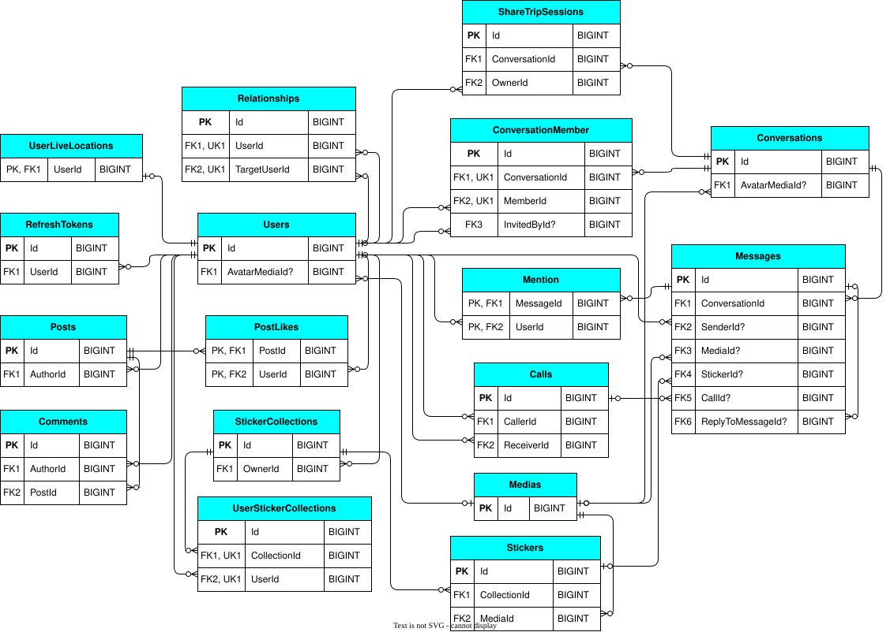
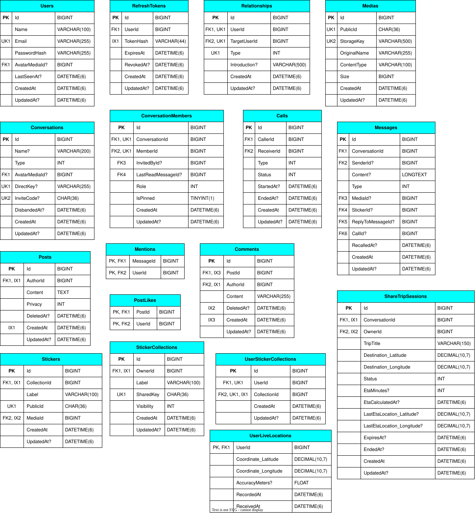
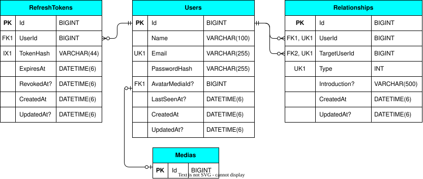
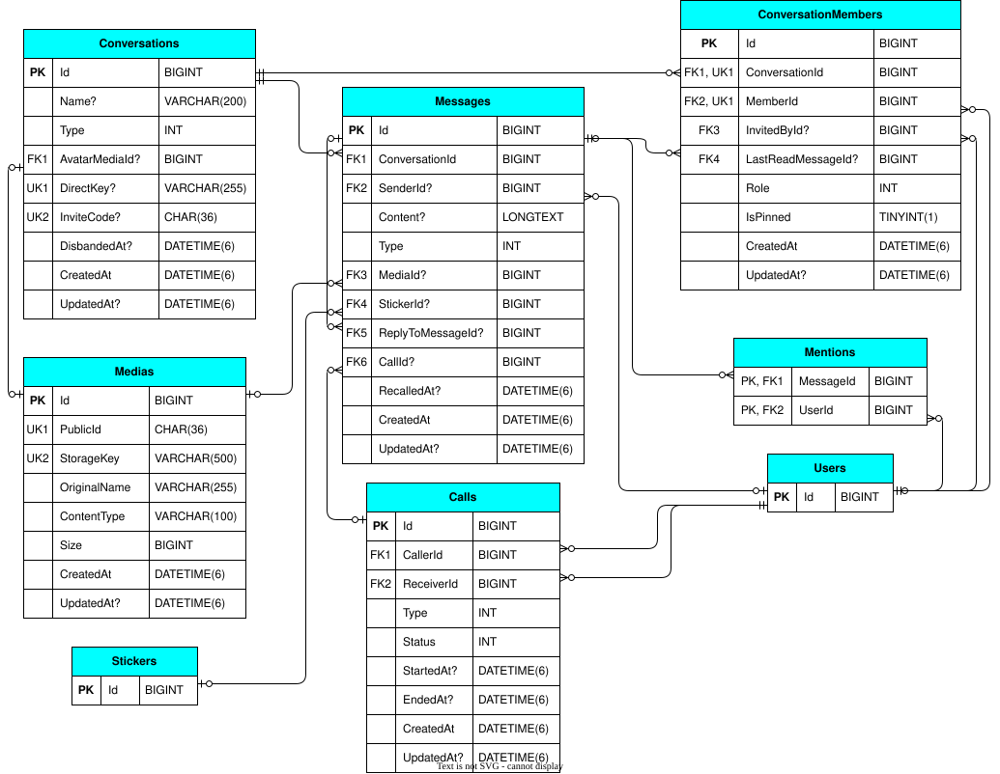
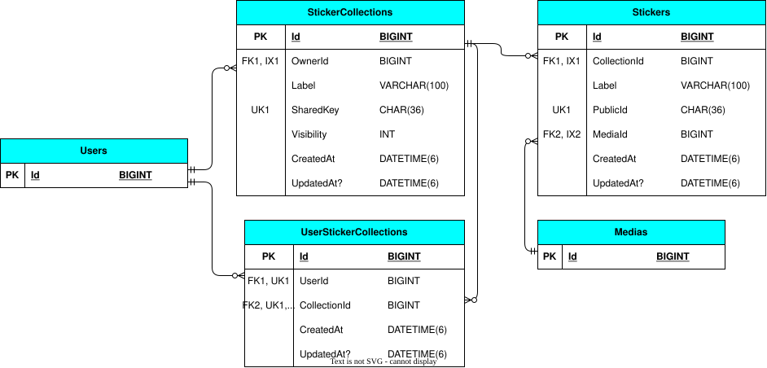
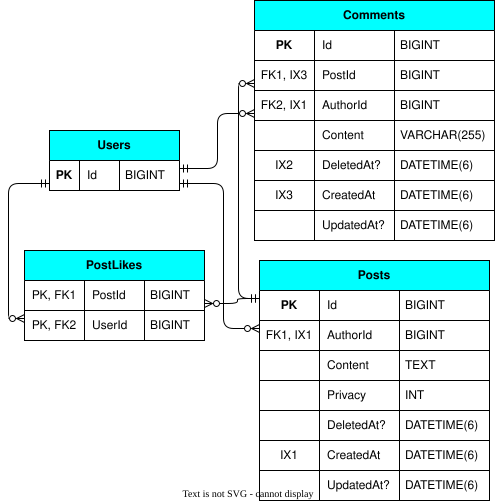
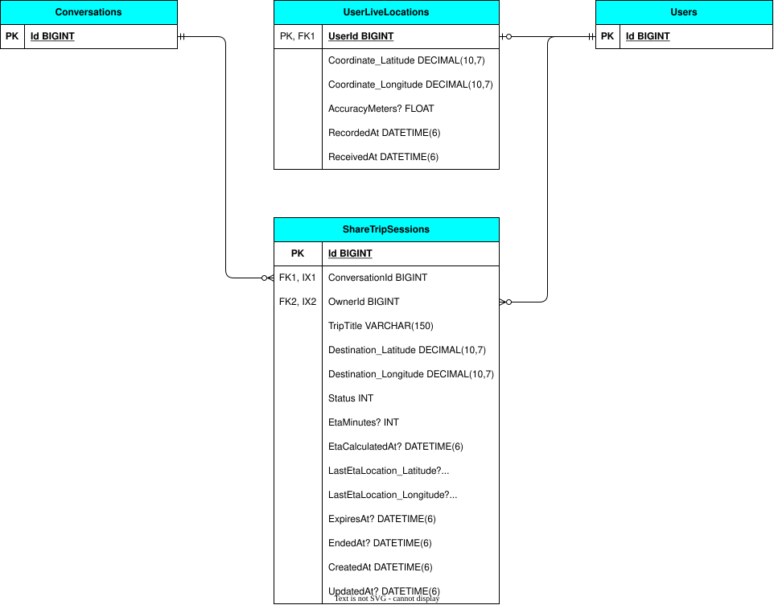

# Tài liệu Thiết kế Cơ sở dữ liệu (Database Design Reference)

## 1. Tổng quan (Overview)

Tài liệu mô tả thiết kế cơ sở dữ liệu cho hệ thống **RealtimeChat**, bao gồm **17 bảng** được chia thành các phân hệ chính sau:

| Phân hệ nghiệp vụ | Các bảng dữ liệu |
|---|---|
| **Tài khoản và quan hệ người dùng** | `Users`, `RefreshTokens`, `Relationships` |
| **Nhắn tin và cuộc gọi** | `Conversations`, `ConversationMembers`, `Messages`, `Mentions`, `Calls`, `Medias` |
| **Hệ thống Sticker** | `StickerCollections`, `Stickers`, `UserStickerCollections` |
| **Bài viết và tương tác** | `Posts`, `Comments`, `PostLikes` |
| **Chia sẻ vị trí và hành trình** | `UserLiveLocations`, `ShareTripSessions` |

---

## 2. Sơ đồ cơ sở dữ liệu (Database Diagrams)

### 2.1. Sơ đồ tổng thể (Architecture Overview)

Sơ đồ thể hiện đầy đủ mối quan hệ giữa tất cả các bảng, rút gọn chi tiết thuộc tính của mỗi bảng (chỉ giữ lại `PK` và `FK`).

  

### 2.2. Sơ đồ từ điển dữ liệu (Data Dictionary)

Sơ đồ chi tiết toàn bộ thuộc tính, kiểu dữ liệu và ràng buộc của tất cả các bảng, lược bỏ các đường liên kết quan hệ để thuận tiện tra cứu.

  

### 2.3. Sơ đồ phân hệ (Module ERDs)

#### 2.3.1. Tài khoản và quan hệ người dùng

  

#### 2.3.2. Nhắn tin và cuộc gọi

  

#### 2.3.3. Hệ thống Sticker

  

#### 2.3.4. Bài viết và tương tác

  

#### 2.3.5. Chia sẻ vị trí và hành trình

  

---

## 3. Đặc tả cơ sở dữ liệu (Table Specifications)

### 3.1. Users

Lưu trữ thông tin định danh, thông tin xác thực và trạng thái hoạt động gần nhất của người dùng.

| Tên cột | Kiểu dữ liệu | Khóa & Ràng buộc | Nullable | Mô tả | Tham chiếu (FK) |
|---|---|---|:---:|---|---|
| `Id` | `BIGINT` | `PK` | Không | Mã định danh người dùng (Auto Increment) | — |
| `Name` | `VARCHAR(100)` | — | Không | Tên hiển thị | — |
| `Email` | `VARCHAR(255)` | `UK` | Không | Địa chỉ email đăng nhập | — |
| `PasswordHash` | `VARCHAR(255)` | — | Không | Chuỗi băm mật khẩu | — |
| `AvatarMediaId` | `BIGINT` | `FK` | Có | Ảnh đại diện của người dùng | `Medias.Id` |
| `LastSeenAt` | `DATETIME(6)` | — | Có | Thời điểm hoạt động trực tuyến gần nhất | — |
| `CreatedAt` | `DATETIME(6)` | — | Không | Thời điểm tạo tài khoản | — |
| `UpdatedAt` | `DATETIME(6)` | — | Có | Thời điểm cập nhật gần nhất | — |

**Các ràng buộc:**
- `UK (Email)`: Đảm bảo mỗi địa chỉ email chỉ gắn với một tài khoản duy nhất.

---

### 3.2. RefreshTokens

Quản lý phiên đăng nhập và vòng đời của refresh token phục vụ cấp lại access token.

| Tên cột | Kiểu dữ liệu | Khóa & Ràng buộc | Nullable | Mô tả | Tham chiếu (FK) |
|---|---|---|:---:|---|---|
| `Id` | `BIGINT` | `PK` | Không | Mã định danh bản ghi token (Auto Increment) | — |
| `UserId` | `BIGINT` | `FK` | Không | Người dùng sở hữu token | `Users.Id` |
| `TokenHash` | `VARCHAR(44)` | `UK` | Không | Chuỗi băm của refresh token | — |
| `ExpiresAt` | `DATETIME(6)` | — | Không | Thời điểm hết hạn token | — |
| `RevokedAt` | `DATETIME(6)` | — | Có | Thời điểm thu hồi token (`NULL` nếu còn hiệu lực) | — |
| `CreatedAt` | `DATETIME(6)` | — | Không | Thời điểm cấp token | — |
| `UpdatedAt` | `DATETIME(6)` | — | Có | Thời điểm cập nhật gần nhất | — |

---

### 3.3. Relationships

Lưu trữ trạng thái quan hệ giữa hai người dùng (lời mời kết bạn, bạn bè, chặn).

| Tên cột | Kiểu dữ liệu | Khóa & Ràng buộc | Nullable | Mô tả | Tham chiếu (FK) |
|---|---|---|:---:|---|---|
| `Id` | `BIGINT` | `PK` | Không | Mã định danh bản ghi quan hệ (Auto Increment) | — |
| `UserId` | `BIGINT` | `FK, UK(1)` | Không | Người dùng khởi tạo hoặc giữ vai trò thứ nhất | `Users.Id` |
| `TargetUserId` | `BIGINT` | `FK, UK(2)` | Không | Người dùng đích trong quan hệ | `Users.Id` |
| `Type` | `INT` | `UK(3)` | Không | Loại quan hệ (`0: FriendRequest`, `1: Friend`, `2: Block`) | — |
| `Introduction` | `VARCHAR(500)` | — | Có | Lời nhắn đính kèm khi gửi lời mời kết bạn | — |
| `CreatedAt` | `DATETIME(6)` | — | Không | Thời điểm tạo bản ghi | — |
| `UpdatedAt` | `DATETIME(6)` | — | Có | Thời điểm cập nhật gần nhất | — |

**Các ràng buộc:**
- `UK (UserId, TargetUserId, Type)`: Không cho phép tạo trùng cùng một loại quan hệ giữa hai người dùng.
- Với `Type = Friend (1)`, ứng dụng chuẩn hóa `UserId < TargetUserId` để mỗi cặp bạn bè chỉ tồn tại một bản ghi duy nhất.

---

### 3.4. Medias

Lưu trữ metadata của các tệp đa phương tiện được tải lên hệ thống.

| Tên cột | Kiểu dữ liệu | Khóa & Ràng buộc | Nullable | Mô tả | Tham chiếu (FK) |
|---|---|---|:---:|---|---|
| `Id` | `BIGINT` | `PK` | Không | Mã định danh tệp tin (Auto Increment) | — |
| `PublicId` | `CHAR(36)` | `UK` | Không | Mã định danh công khai (UUID) | — |
| `OriginalName` | `VARCHAR(255)` | — | Không | Tên tệp gốc khi tải lên | — |
| `ContentType` | `VARCHAR(100)` | — | Không | Định dạng MIME của tệp | — |
| `Size` | `BIGINT` | — | Không | Dung lượng tệp tính theo bytes | — |
| `StorageKey` | `VARCHAR(500)` | `UK` | Không | Khóa định danh đường dẫn lưu trữ vật lý | — |
| `CreatedAt` | `DATETIME(6)` | — | Không | Thời điểm tải lên | — |
| `UpdatedAt` | `DATETIME(6)` | — | Có | Thời điểm cập nhật gần nhất | — |

**Các ràng buộc:**
- `UK (PublicId)`: Mã định danh công khai duy nhất dùng để truy xuất tệp từ client.
- `UK (StorageKey)`: Đảm bảo đường dẫn lưu trữ tệp vật lý không trùng lặp.

---

### 3.5. Conversations

Lưu trữ thông tin cuộc trò chuyện trực tiếp (1-1) và cuộc trò chuyện nhóm.

| Tên cột | Kiểu dữ liệu | Khóa & Ràng buộc | Nullable | Mô tả | Tham chiếu (FK) |
|---|---|---|:---:|---|---|
| `Id` | `BIGINT` | `PK` | Không | Mã định danh cuộc trò chuyện (Auto Increment) | — |
| `Type` | `INT` | — | Không | Loại cuộc trò chuyện (`0: Direct`, `1: Group`) | — |
| `DirectKey` | `VARCHAR(255)` | `UK` | Có | Khóa định danh cặp chat 1-1 (`NULL` với nhóm) | — |
| `Name` | `VARCHAR(200)` | — | Có | Tên nhóm trò chuyện (`NULL` với chat 1-1) | — |
| `AvatarMediaId` | `BIGINT` | `FK` | Có | Ảnh đại diện của nhóm | `Medias.Id` |
| `DisbandedAt` | `DATETIME(6)` | — | Có | Thời điểm giải tán nhóm (`NULL` nếu đang hoạt động) | — |
| `InviteCode` | `CHAR(36)` | `UK` | Có | Mã UUID dùng cho liên kết mời vào nhóm (`NULL` với chat 1-1) | — |
| `CreatedAt` | `DATETIME(6)` | — | Không | Thời điểm tạo cuộc trò chuyện | — |
| `UpdatedAt` | `DATETIME(6)` | — | Có | Thời điểm cập nhật gần nhất | — |

**Các ràng buộc:**
- `UK (DirectKey)`: Định dạng `{minUserId}:{maxUserId}`, ngăn tạo trùng phòng chat 1-1 giữa cùng một cặp người dùng.
- `UK (InviteCode)`: Đảm bảo mã mời tham gia nhóm là duy nhất.

---

### 3.6. ConversationMembers

Quản lý danh sách thành viên, vai trò và trạng thái đọc tin nhắn của từng người dùng trong cuộc trò chuyện.

| Tên cột | Kiểu dữ liệu | Khóa & Ràng buộc | Nullable | Mô tả | Tham chiếu (FK) |
|---|---|---|:---:|---|---|
| `Id` | `BIGINT` | `PK` | Không | Mã định danh bản ghi thành viên (Auto Increment) | — |
| `ConversationId` | `BIGINT` | `FK, UK(1)` | Không | Cuộc trò chuyện tham gia | `Conversations.Id` |
| `MemberId` | `BIGINT` | `FK, UK(2)` | Không | Người dùng là thành viên | `Users.Id` |
| `Role` | `INT` | — | Không | Vai trò trong hội thoại (`0: Admin`, `1: Member`) | — |
| `LastReadMessageId` | `BIGINT` | — | Có | ID tin nhắn cuối cùng thành viên đã đọc | — |
| `IsPinned` | `TINYINT(1)` | — | Không | Cờ đánh dấu ghim cuộc trò chuyện đối với thành viên | — |
| `InvitedById` | `BIGINT` | `FK` | Có | Người dùng đã mời thành viên vào nhóm | `Users.Id` |
| `CreatedAt` | `DATETIME(6)` | — | Không | Thời điểm tham gia cuộc trò chuyện | — |
| `UpdatedAt` | `DATETIME(6)` | — | Có | Thời điểm cập nhật gần nhất | — |

**Các ràng buộc:**
- `UK (ConversationId, MemberId)`: Đảm bảo mỗi người dùng chỉ xuất hiện tối đa một lần trong một cuộc trò chuyện.

---

### 3.7. Messages

Lưu trữ các tin nhắn phát sinh trong cuộc trò chuyện.

| Tên cột | Kiểu dữ liệu | Khóa & Ràng buộc | Nullable | Mô tả | Tham chiếu (FK) |
|---|---|---|:---:|---|---|
| `Id` | `BIGINT` | `PK` | Không | Mã định danh tin nhắn (Auto Increment) | — |
| `ConversationId` | `BIGINT` | `FK, IX(1)` | Không | Cuộc trò chuyện chứa tin nhắn | `Conversations.Id` |
| `SenderId` | `BIGINT` | `FK` | Có | Người gửi (`NULL` nếu là tin nhắn hệ thống) | `Users.Id` |
| `Type` | `INT` | — | Không | Loại tin nhắn (`0: Text`, `1: Media`, `2: Sticker`, `3: Call`, `4: System`) | — |
| `Content` | `LONGTEXT` | — | Có | Nội dung văn bản của tin nhắn | — |
| `MediaId` | `BIGINT` | `FK` | Có | Tệp đính kèm (khi `Type = Media`) | `Medias.Id` |
| `CallId` | `BIGINT` | `FK` | Có | Cuộc gọi liên kết (khi `Type = Call`) | `Calls.Id` |
| `StickerId` | `BIGINT` | `FK` | Có | Sticker gửi kèm (khi `Type = Sticker`) | `Stickers.Id` |
| `ReplyToMessageId` | `BIGINT` | `FK` | Có | Tin nhắn gốc được trả lời (cùng `ConversationId`) | `Messages.Id` |
| `RecalledAt` | `DATETIME(6)` | — | Có | Thời điểm thu hồi tin nhắn (`NULL` nếu chưa thu hồi) | — |
| `CreatedAt` | `DATETIME(6)` | `IX(2)` | Không | Thời điểm tạo tin nhắn | — |
| `UpdatedAt` | `DATETIME(6)` | — | Có | Thời điểm cập nhật gần nhất | — |

**Các ràng buộc:**
- `IX (ConversationId, CreatedAt)`: Tối ưu truy vấn và phân trang lịch sử tin nhắn trong cuộc trò chuyện theo thứ tự thời gian.

---

### 3.8. Mentions

Lưu trữ danh sách người dùng được nhắc tên (`@mention`) trong một tin nhắn.

| Tên cột | Kiểu dữ liệu | Khóa & Ràng buộc | Nullable | Mô tả | Tham chiếu (FK) |
|---|---|---|:---:|---|---|
| `MessageId` | `BIGINT` | `PK(1), FK` | Không | Tin nhắn chứa thẻ nhắc tên | `Messages.Id` |
| `UserId` | `BIGINT` | `PK(2), FK` | Không | Người dùng được nhắc tên | `Users.Id` |

**Các ràng buộc:**
- `PK (MessageId, UserId)`: Đảm bảo một người dùng chỉ được gắn thẻ nhắc tên tối đa một lần trong cùng một tin nhắn.

---

### 3.9. Calls

Lưu trữ thông tin và trạng thái các cuộc gọi âm thanh/video giữa hai người dùng.

| Tên cột | Kiểu dữ liệu | Khóa & Ràng buộc | Nullable | Mô tả | Tham chiếu (FK) |
|---|---|---|:---:|---|---|
| `Id` | `BIGINT` | `PK` | Không | Mã định danh cuộc gọi (Auto Increment) | — |
| `CallerId` | `BIGINT` | `FK` | Không | Người khởi tạo cuộc gọi | `Users.Id` |
| `ReceiverId` | `BIGINT` | `FK` | Không | Người nhận cuộc gọi | `Users.Id` |
| `Type` | `INT` | — | Không | Loại cuộc gọi (`0: Audio`, `1: Video`) | — |
| `Status` | `INT` | — | Không | Trạng thái (`0: Ringing`, `1: Accepted`, `2: Rejected`, `3: Cancelled`, `4: Missed`, `5: Ended`) | — |
| `StartedAt` | `DATETIME(6)` | — | Có | Thời điểm cuộc gọi được kết nối | — |
| `EndedAt` | `DATETIME(6)` | — | Có | Thời điểm kết thúc cuộc gọi | — |
| `CreatedAt` | `DATETIME(6)` | — | Không | Thời điểm bắt đầu đổ chuông | — |
| `UpdatedAt` | `DATETIME(6)` | — | Có | Thời điểm cập nhật gần nhất | — |

---

### 3.10. StickerCollections

Lưu trữ thông tin các bộ sưu tập sticker.

| Tên cột | Kiểu dữ liệu | Khóa & Ràng buộc | Nullable | Mô tả | Tham chiếu (FK) |
|---|---|---|:---:|---|---|
| `Id` | `BIGINT` | `PK` | Không | Mã định danh bộ sưu tập (Auto Increment) | — |
| `OwnerId` | `BIGINT` | `FK` | Không | Người tạo và sở hữu bộ sưu tập | `Users.Id` |
| `Label` | `VARCHAR(100)` | — | Không | Tên hiển thị của bộ sưu tập | — |
| `SharedKey` | `CHAR(36)` | `UK` | Không | Mã UUID dùng để chia sẻ bộ sưu tập | — |
| `Visibility` | `INT` | — | Không | Chế độ hiển thị (`0: Private`, `1: Public`) | — |
| `CreatedAt` | `DATETIME(6)` | — | Không | Thời điểm tạo bộ sưu tập | — |
| `UpdatedAt` | `DATETIME(6)` | — | Có | Thời điểm cập nhật gần nhất | — |

**Các ràng buộc:**
- `UK (SharedKey)`: Đảm bảo mã chia sẻ bộ sưu tập sticker là duy nhất.

---

### 3.11. Stickers

Lưu trữ từng sticker thuộc một bộ sưu tập.

| Tên cột | Kiểu dữ liệu | Khóa & Ràng buộc | Nullable | Mô tả | Tham chiếu (FK) |
|---|---|---|:---:|---|---|
| `Id` | `BIGINT` | `PK` | Không | Mã định danh sticker (Auto Increment) | — |
| `CollectionId` | `BIGINT` | `FK` | Không | Bộ sưu tập chứa sticker | `StickerCollections.Id` |
| `Label` | `VARCHAR(100)` | — | Không | Nhãn mô tả của sticker | — |
| `PublicId` | `CHAR(36)` | `UK` | Không | Mã định danh công khai (UUID) | — |
| `MediaId` | `BIGINT` | `FK` | Không | Tệp hình ảnh của sticker | `Medias.Id` |
| `CreatedAt` | `DATETIME(6)` | — | Không | Thời điểm tạo sticker | — |
| `UpdatedAt` | `DATETIME(6)` | — | Có | Thời điểm cập nhật gần nhất | — |

**Các ràng buộc:**
- `UK (PublicId)`: Mã định danh công khai duy nhất của từng sticker.

---

### 3.12. UserStickerCollections

Lưu trữ liên kết các bộ sưu tập sticker mà người dùng đã thêm vào thư viện cá nhân.

| Tên cột | Kiểu dữ liệu | Khóa & Ràng buộc | Nullable | Mô tả | Tham chiếu (FK) |
|---|---|---|:---:|---|---|
| `Id` | `BIGINT` | `PK` | Không | Mã định danh bản ghi (Auto Increment) | — |
| `UserId` | `BIGINT` | `FK, UK(1)` | Không | Người dùng lưu bộ sưu tập | `Users.Id` |
| `CollectionId` | `BIGINT` | `FK, UK(2)` | Không | Bộ sưu tập được lưu | `StickerCollections.Id` |
| `CreatedAt` | `DATETIME(6)` | — | Không | Thời điểm lưu bộ sưu tập | — |
| `UpdatedAt` | `DATETIME(6)` | — | Có | Thời điểm cập nhật gần nhất | — |

**Các ràng buộc:**
- `UK (UserId, CollectionId)`: Ngăn người dùng lưu trùng một bộ sưu tập sticker nhiều lần.

---

### 3.13. Posts

Lưu trữ bài viết của người dùng trên bảng tin.

| Tên cột | Kiểu dữ liệu | Khóa & Ràng buộc | Nullable | Mô tả | Tham chiếu (FK) |
|---|---|---|:---:|---|---|
| `Id` | `BIGINT` | `PK` | Không | Mã định danh bài viết (Auto Increment) | — |
| `AuthorId` | `BIGINT` | `FK, IX(1)` | Không | Tác giả bài viết | `Users.Id` |
| `Content` | `TEXT` | — | Không | Nội dung bài viết | — |
| `Privacy` | `INT` | — | Không | Quyền riêng tư (`0: Public`, `1: Friends`, `2: Private`) | — |
| `DeletedAt` | `DATETIME(6)` | — | Có | Thời điểm xóa mềm bài viết (`NULL` nếu chưa xóa) | — |
| `CreatedAt` | `DATETIME(6)` | `IX(2)` | Không | Thời điểm đăng bài | — |
| `UpdatedAt` | `DATETIME(6)` | — | Có | Thời điểm cập nhật gần nhất | — |

**Các ràng buộc:**
- `IX (AuthorId, CreatedAt)`: Tối ưu truy vấn danh sách bài viết của tác giả theo thời gian đăng.

---

### 3.14. Comments

Lưu trữ bình luận của người dùng trên bài viết.

| Tên cột | Kiểu dữ liệu | Khóa & Ràng buộc | Nullable | Mô tả | Tham chiếu (FK) |
|---|---|---|:---:|---|---|
| `Id` | `BIGINT` | `PK` | Không | Mã định danh bình luận (Auto Increment) | — |
| `PostId` | `BIGINT` | `FK, IX(1)` | Không | Bài viết được bình luận | `Posts.Id` |
| `AuthorId` | `BIGINT` | `FK` | Không | Tác giả bình luận | `Users.Id` |
| `Content` | `VARCHAR(255)` | — | Không | Nội dung bình luận | — |
| `DeletedAt` | `DATETIME(6)` | `IX` | Có | Thời điểm xóa mềm bình luận (`NULL` nếu chưa xóa) | — |
| `CreatedAt` | `DATETIME(6)` | `IX(2)` | Không | Thời điểm tạo bình luận | — |
| `UpdatedAt` | `DATETIME(6)` | — | Có | Thời điểm cập nhật gần nhất | — |

**Các ràng buộc:**
- `IX (PostId, CreatedAt)`: Tối ưu truy vấn và phân trang bình luận theo bài viết.

---

### 3.15. PostLikes

Lưu trữ lượt thích của người dùng đối với bài viết.

| Tên cột | Kiểu dữ liệu | Khóa & Ràng buộc | Nullable | Mô tả | Tham chiếu (FK) |
|---|---|---|:---:|---|---|
| `PostId` | `BIGINT` | `PK(1), FK` | Không | Bài viết được thích | `Posts.Id` |
| `UserId` | `BIGINT` | `PK(2), FK` | Không | Người dùng thích bài viết | `Users.Id` |

**Các ràng buộc:**
- `PK (PostId, UserId)`: Đảm bảo mỗi người dùng chỉ thích một bài viết tối đa một lần.

---

### 3.16. UserLiveLocations

Lưu trữ vị trí GPS trực tiếp mới nhất của mỗi người dùng.

| Tên cột | Kiểu dữ liệu | Khóa & Ràng buộc | Nullable | Mô tả | Tham chiếu (FK) |
|---|---|---|:---:|---|---|
| `UserId` | `BIGINT` | `PK, FK` | Không | Người dùng phát vị trí | `Users.Id` |
| `Coordinate_Latitude` | `DECIMAL(10,7)` | — | Không | Vĩ độ hiện tại | — |
| `Coordinate_Longitude` | `DECIMAL(10,7)` | — | Không | Kinh độ hiện tại | — |
| `AccuracyMeters` | `FLOAT` | — | Có | Độ chính xác định vị tính bằng mét (`>= 0`) | — |
| `RecordedAt` | `DATETIME(6)` | — | Không | Thời điểm thiết bị ghi nhận tọa độ | — |
| `ReceivedAt` | `DATETIME(6)` | — | Không | Thời điểm máy chủ nhận tọa độ | — |

**Các ràng buộc:**
- `PK, FK (UserId)`: Quan hệ 1-1 với bảng `Users`, mỗi người dùng chỉ lưu tối đa một bản ghi vị trí trực tiếp mới nhất.

---

### 3.17. ShareTripSessions

Quản lý phiên chia sẻ hành trình trực tiếp trong cuộc trò chuyện và trạng thái tính toán thời gian đến dự kiến (ETA).

| Tên cột | Kiểu dữ liệu | Khóa & Ràng buộc | Nullable | Mô tả | Tham chiếu (FK) |
|---|---|---|:---:|---|---|
| `Id` | `BIGINT` | `PK` | Không | Mã định danh phiên chia sẻ hành trình (Auto Increment) | — |
| `OwnerId` | `BIGINT` | `FK` | Không | Người dùng chia sẻ hành trình | `Users.Id` |
| `ConversationId` | `BIGINT` | `FK` | Không | Cuộc trò chuyện nhận chia sẻ hành trình | `Conversations.Id` |
| `TripTitle` | `VARCHAR(150)` | — | Không | Tiêu đề chuyến đi | — |
| `Destination_Latitude` | `DECIMAL(10,7)` | — | Không | Vĩ độ điểm đến | — |
| `Destination_Longitude` | `DECIMAL(10,7)` | — | Không | Kinh độ điểm đến | — |
| `EtaMinutes` | `INT` | — | Có | Thời gian dự kiến đến nơi tính bằng phút (`>= 0`) | — |
| `EtaCalculatedAt` | `DATETIME(6)` | — | Có | Thời điểm tính toán ETA gần nhất | — |
| `LastEtaLocation_Latitude` | `DECIMAL(10,7)` | — | Có | Vĩ độ tại lần tính ETA gần nhất | — |
| `LastEtaLocation_Longitude` | `DECIMAL(10,7)` | — | Có | Kinh độ tại lần tính ETA gần nhất | — |
| `Status` | `INT` | — | Không | Trạng thái phiên (`0: Active`, `1: Ended`, `2: Expired`) | — |
| `ExpiresAt` | `DATETIME(6)` | — | Có | Thời điểm phiên tự động hết hạn | — |
| `EndedAt` | `DATETIME(6)` | — | Có | Thời điểm kết thúc phiên | — |
| `CreatedAt` | `DATETIME(6)` | — | Không | Thời điểm bắt đầu chia sẻ hành trình | — |
| `UpdatedAt` | `DATETIME(6)` | — | Có | Thời điểm cập nhật gần nhất | — |
